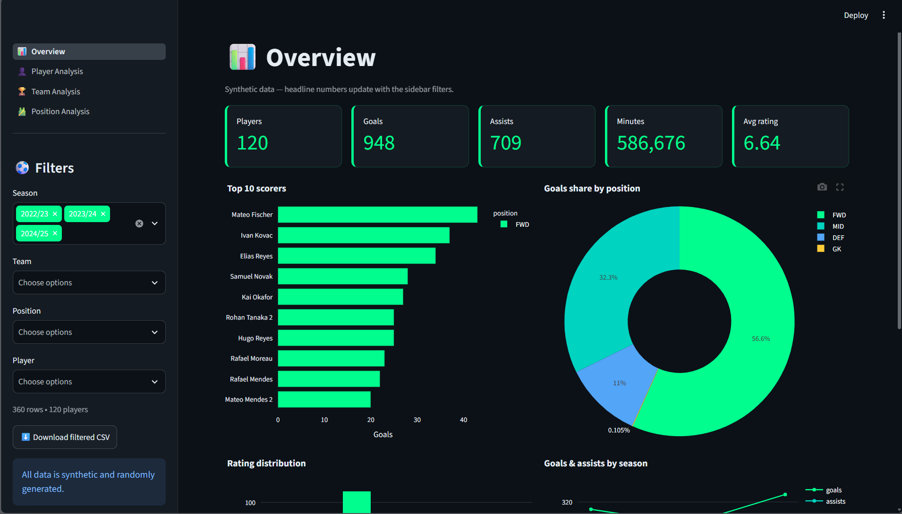
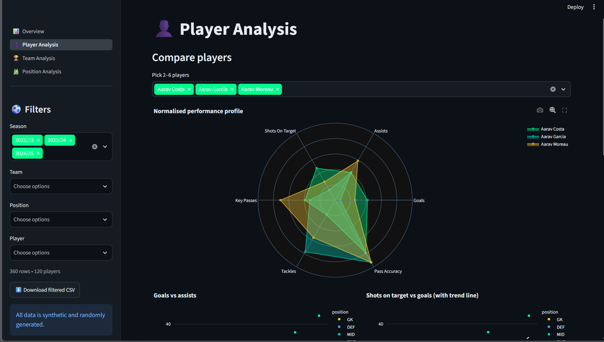
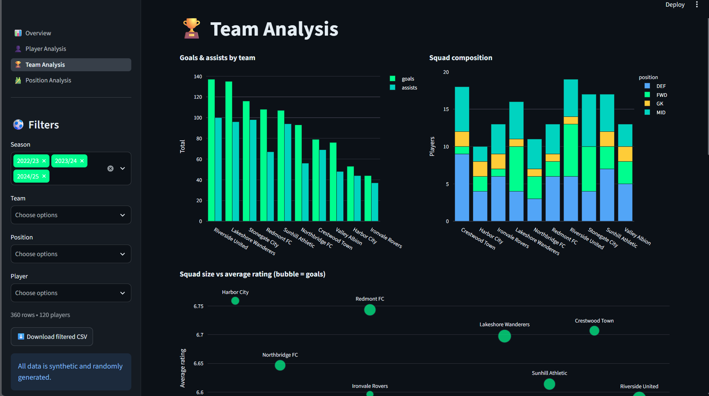
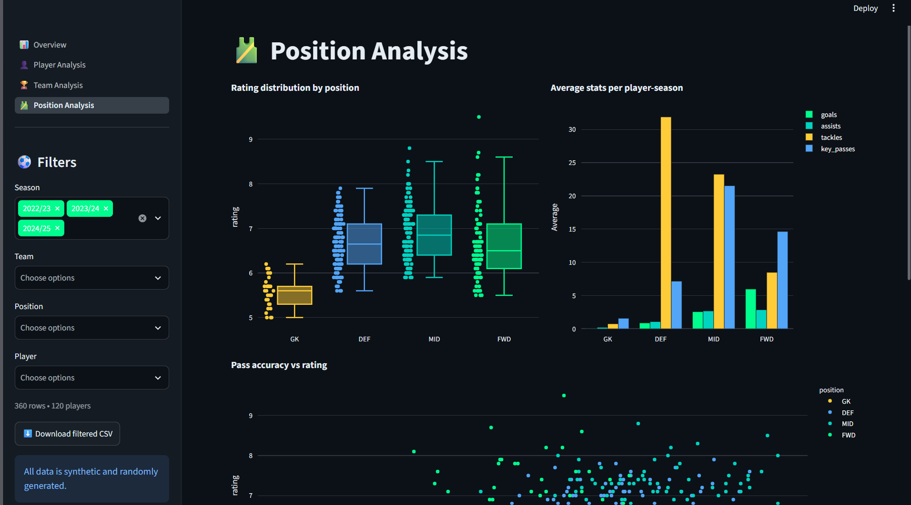
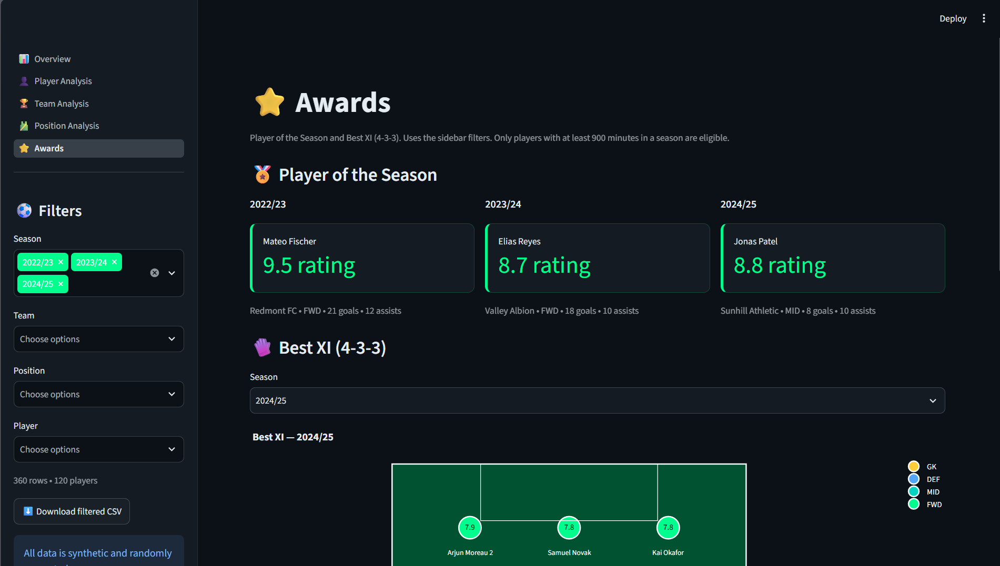
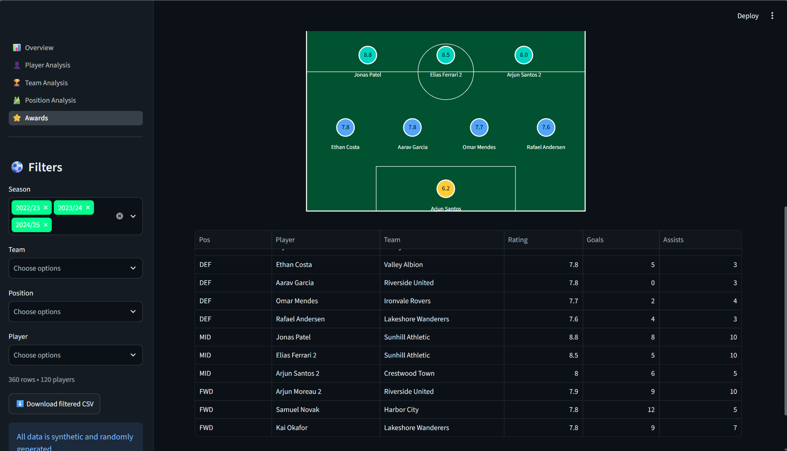

# ⚽ Football Player Performance Analytics Dashboard

An interactive multi-page analytics dashboard built with **Python + Streamlit + Plotly**.

> ⚠️ **Synthetic data notice:** every player, club and statistic is randomly generated
> for demonstration. Nothing here represents real football players, clubs or results.

## Features
- **Overview** – KPI cards (players, goals, assists, minutes, average rating), top-10 scorers, goals share by position, rating histogram, season trend
- **Player Analysis** – radar comparison of 2–6 players, goals vs assists, shots-on-target vs goals with trend line, searchable stats table, CSV download
- **Team Analysis** – goals/assists per team, squad composition, squad size vs rating, team radar comparison, summary table
- **Position Analysis** – rating box plots, average stats per position, pass accuracy vs rating, deep-dive tabs for GK / DEF / MID / FWD
- **Cascading sidebar filters** – season → team → position → player; every chart updates instantly
- **Validation** – missing-column check, empty-filter warning, no-match search message
- **Dark football-green theme** via `.streamlit/config.toml` + custom CSS
- **Awards** – Player of the Season cards and a Best XI (4-3-3) drawn on a pitch

## Project structure
```
football-analytics-dashboard/
├── app.py                 # entry point: page config, filters, navigation
├── data_generator.py      # builds football_players.csv (seed 42)
├── football_players.csv   # 120 players x 3 seasons = 360 rows
├── requirements.txt
├── .streamlit/config.toml # dark green theme
├── utils/
│   ├── data_loader.py     # load + validate CSV
│   ├── filters.py         # sidebar filters + CSV download
│   ├── kpis.py            # five KPI functions
│   └── theme.py           # CSS, Plotly styling, helpers
└── views/
    ├── overview.py
    ├── players.py
    ├── teams.py
    └── positions.py
```

## Run locally
```bash
python -m venv .venv
source .venv/bin/activate        # Windows: .venv\Scripts\activate
pip install -r requirements.txt
python data_generator.py         # optional: CSV is already included
streamlit run app.py
```
Open http://localhost:8501

## Deploy (Streamlit Community Cloud)
1. Push this folder to a public GitHub repo.
2. Go to https://share.streamlit.io, click **New app**, pick the repo.
3. Set the main file to `app.py` and deploy.

## Dataset columns
`player_id, player_name, team, position, season, nationality, age, matches_played,
minutes_played, goals, assists, shots, shots_on_target, key_passes, pass_accuracy,
tackles, interceptions, saves, clean_sheets, yellow_cards, red_cards, rating`

**Rating** = 0.30·goals + 0.20·assists + 0.20·pass accuracy + 0.15·defensive actions
+ 0.15·minutes, each min-max normalised, then scaled to 5.0–9.5.

## Tech stack
Python · Streamlit · Pandas · NumPy · Plotly

## Screenshots
## Screenshots






